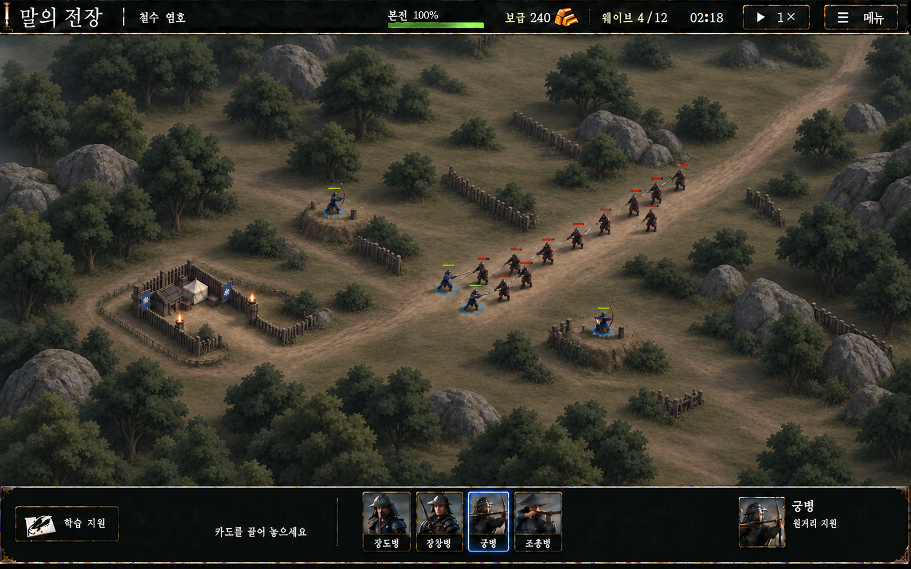
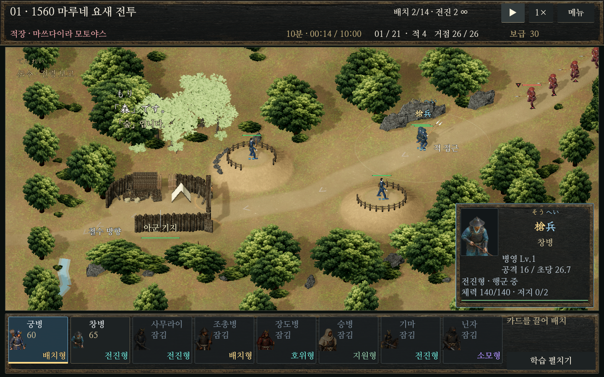

# 말의 전장

전국시대 전장을 배경으로 일본어를 학습하는 PC용 오프라인 타워 디펜스입니다. **카메라 각도가 고정된 쿼터뷰 게임**이며, 고정 진지의 사격과 계속 모집·전진하는 병력의 교전을 함께 다룹니다. Godot 4.7.2를 사용하며, 현재는 Stage 01의 전장 미술과 실제 게임 화면의 일관성을 개선하고 있습니다.

**2026-10-11 갱신:** 최신 개발 소스, Blender 제작 원본과 격리 시험본을 함께 보관합니다. 아래 실제 화면은 2026-10-10에 촬영한 Blender 자산 시험본입니다. 목표 이미지 수준의 미술 합격이나 배포 완료를 뜻하지 않습니다.

## 게임과 화면 제작의 전제

이 저장소를 처음 읽고 그래픽 방향을 검토할 때는 다음 조건을 함께 보아야 합니다. 현재 구현 설명은 아래 사진에 사용한 **격리 Godot 시험본**을 기준으로 합니다.

| 항목 | 현재 전제와 검토 범위 |
| --- | --- |
| 카메라 | 전장을 비스듬히 내려다보는 **고정 각도**입니다. 현재 Stage 01은 직교 투영, 폭 23.5, 고도 44도이며 창 크기가 바뀌어도 같은 각도를 사용합니다. 현재 전장의 사용자 확대·화면 이동도 비활성입니다. 자유 회전을 전제로 자산 제작 방식을 정하지 않습니다. |
| 플레이 | 병종을 선택하고 비용·생산 시간을 거쳐 병력을 배치하거나 출진시킵니다. 적이 접근하면 전투가 진행되며 플레이어는 모집·배치·선택·학습에 관여합니다. |
| 전선 | 고정 사격·지원 진지와 전진 병력이 서로 다른 역할을 맡습니다. 소수의 강한 병력으로 화면을 채우는 것보다 반복 모집과 소모, 여러 병력이 같은 길에서 싸우는 흐름이 사용자 요구입니다. |
| 적의 진입 | 적은 **보이는 길 중간에서 갑자기 나타나는 대신 화면 밖 접근 구간에서 실제로 생성되어 걸어 들어와야 합니다.** 동일 개체 ID의 화면 밖 생성부터 가시 영역 진입까지 실제 관측했습니다. |
| 일본어 학습 | 전장 문맥·위치와 연결되는 학습, 문제 응답, 전투 복귀가 게임의 일부입니다. 보기 좋은 캡처를 위해 학습 문구나 필수 HUD를 숨길 수 없습니다. |
| 현행 콘텐츠 범위 | 사진의 시험본은 현재 맵 목록 1개인 Stage 01 중심입니다. 40단계 이야기·여러 임무 모드는 별도 계획이며 전부 구현·검증된 콘텐츠로 계산하지 않습니다. |
| 검토 화면 | 1440×900과 1280×800 전체 화면에서 요새·사격대·교전로·병사·학습 표시를 함께 봅니다. 확대된 자산 단독 렌더만으로 미술 합격을 판단하지 않습니다. |

고정된 것은 **보는 각도**입니다. 병사·화살·전투 효과·선택 표시·학습 연결까지 정지된 배경 그림으로 대체한다는 뜻은 아닙니다.

### 현재 규칙과 아직 해결되지 않은 플레이 요구

- **아군 병종:** 데이터에는 궁병·창병·사무라이·조총병·장도병·승병·기마 무장·닌자가 있으며 해금에 따라 사용할 수 있습니다. 이번 실제 전장 검증은 유료 궁병·창병 중심이므로 모든 병종의 동작을 다시 검증한 결과는 아닙니다.
- **전진형 정원:** 창병·사무라이·기마 무장은 기지에서 출진하며, 현재 코드에는 병력 수와 생산 주문 수 상한이 없습니다. 금화와 생산 시간은 그대로 필요합니다. 이는 대규모 병력의 성능까지 검증했다는 뜻은 아닙니다.
- **배치형 정원:** 비전진형은 현재 Stage 01의 정원 14와 배치형 생산 주문 상한 24를 적용받습니다. 정원에는 예약 병력도 포함하므로 빈 진지가 있어도 정원 조건을 만족해야 합니다. 전진형에 옛 전체 주문 24개 제한을 적용하지 않습니다.
- **적 병종:** 기본 생성 계열은 일반병(`raider`), 질주병(`runner`), 방패병(`shield`), 중장병(`heavy`), 지휘관(`commander`)입니다. 적 궁병·조총병·사무라이·기마병의 코드도 있지만 **현재 Stage 01 자연 편성에 모두 등장하는 것은 아닙니다.** 추가 편성은 3파상 이후에 각각 단계 2·6·5·9 이상의 조건을 사용하며, 장도병 미해금 시 진지 공격 적을 억제하는 보호 규칙도 남아 있습니다. 적 원거리 후방 지원을 보고 싶다는 요구를 현재 맵에서 해결한 것으로 보고하지 않습니다.
- **교전과 밸런스:** 같은 길의 여러 병력이 싸우고 전사한 병력을 보충하는 흐름이 목표입니다. 창병이 상대보다 너무 강하다는 피드백과 밀집 교전 연출의 부족은 별도 검토 과제로 남아 있습니다. 최근 미술 회차에서는 공격력·체력·모션을 수정하지 않았습니다.
- **학습 연결:** Stage 01의 숲·강·산 표식(`森`·`川`·`山`)과 일본어 읽기·뜻·문법을 연결합니다. 전장 문맥 과제와 파상 사이 퀴즈 이후 전투로 돌아옵니다. 최근 실행에서 확인한 범위는 문맥 학습 복귀 2회와 퀴즈 복귀 1회입니다.
- **Stage 01의 임무:** 마루네 요새 전방 방어와 후방 철수 엄호라는 서사를 사용합니다. 현재 시간제 전투의 거점 생존 판정과, 계획 문서의 실제 탈출·호송·도착 판정은 구분해야 합니다. 후자의 임무 모드 전체가 구현됐다는 뜻은 아닙니다.

확인 근거: 시험본의 [맵 설정](tools/art-authoring-pilot/work/20261010T050221Z-581667a1/godot-candidate/native/maps.json), [카메라 제어](tools/art-authoring-pilot/work/20261010T050221Z-581667a1/godot-candidate/native/battle_camera.gd), [모집·적 편성·전투 규칙](tools/art-authoring-pilot/work/20261010T050221Z-581667a1/godot-candidate/native/game.gd), [병종 데이터](tools/art-authoring-pilot/work/20261010T050221Z-581667a1/godot-candidate/native/units.json), [학습 계획](tools/art-authoring-pilot/work/20261010T050221Z-581667a1/godot-candidate/native/learning_plans.json). 세부 수치 변경을 제안할 때는 과거 보고서보다 현재 후보 소스를 우선 확인합니다.

## 목표 이미지와 실제 게임

### 목표로 정한 구상 이미지

Stage 01의 공간 구성과 최종 화면 품질 기준입니다. 이 이미지가 어떤 엔진·2D/3D 방식으로 제작됐는지는 확인되지 않았으며, 이미지의 외관을 보고 제작 기술을 확정하지 않습니다.



### 실제 Godot 전장 캡처

1440×900 원본 전체 화면입니다. HUD·학습 문구·선택 패널을 유지했으며, 좌측 상단의 밝은 나무가 새 Blender 자산입니다. 격리 시험 후보에서 촬영했고 기존 실행본 R8에는 채택하지 않았습니다.



목표 구도의 핵심은 좌하단의 작은 목책 요새와 입구, 두 사격대, 우상단 적 접근로와 중앙 교전 공간, 왼쪽·하단 전경 및 상단·우측의 불규칙하게 이어진 숲입니다. 흙·풀 경계, 시설의 높이와 측면, 병사의 발과 지면 접촉, 차분한 명암이 한 화면에서 어울려야 합니다. 나무 수나 잎 레이어만 늘리는 것으로 이 목표가 충족되지는 않습니다.

수관은 요새 입구·사격대·교전 병사·학습 위치의 시야를 확보하도록 구성해야 합니다. 나무 너머로 시설을 강제로 그리거나 깊이 검사를 해제하는 방식은 채택하지 않습니다. 화면에 보이는 줄기·장애물과 실제 통행·배치 판정도 일치해야 합니다.

## 현재 렌더링과 2D 그래픽 검토

**현재 구현은 Godot의 3D 지형·시설·병사와 이미지 기반 수관 등이 함께 있는 상태입니다. 2D 전환은 검토 중인 선택지이며, 결정되거나 구현된 변경이 아닙니다.** 고정 카메라라는 게임 조건과 현재 3D 구현은 별개의 사실입니다.

대화에서 설명한 2D 방향은 **사실적인 질감과 그려진 입체감을 가진 쿼터뷰 전략게임 화면**입니다. 지면의 흙·풀·낙엽을 그리고, 나무와 건물에 같은 시점의 윗면·옆면·명암을 담으며, 병사는 이동 방향과 행동에 맞는 애니메이션을 사용한다는 구상입니다. 구체적인 제작 방식과 자산 수량은 아직 정하지 않았습니다.

| 검토 방향 | 제작 방식 | 확인해야 할 비용과 제약 |
| --- | --- | --- |
| 현재 3D 방식 개선 | 기존 메시·재질·조명 아래에서 공통 미술 기준을 맞춥니다. | 기존 기능 연결을 유지하면서도 수관 형태, 재질 반응, 지면 접촉과 실제 전투 성능을 개선해야 합니다. |
| 2D 또는 사전 렌더링 방식 | 고정 각도에 맞춘 배경·시설·수목 이미지와 병사 애니메이션을 사용합니다. 기존 Blender 원본을 같은 카메라·조명에서 이미지로 렌더링하는 방법도 검토할 수 있습니다. | 앞뒤 가림, 높이, 발 접촉, 공격 시점, 선택·배치 좌표를 맞춰야 합니다. 병사 방향별·행동별 프레임과 해상도별 선명도, 이미지 메모리 비용이 생깁니다. |
| 혼합 방식 | 배경·시설 일부는 이미지로, 병사나 필요한 부분은 3D로 유지합니다. | 두 표현의 시점·색·조명·그림자·앞뒤 가림이 맞아야 하며, 현재의 미술 부조화를 다른 형태로 반복할 수 있습니다. |

고정 시점은 화면에 보이는 방향에 맞춰 자산을 제작할 수 있는 조건입니다. 그러나 **2D라는 이유만으로 목표 품질이나 60FPS가 보장되지는 않습니다.** 한 장의 배경 이미지만 교체해서는 높이·가림·입력·전투 연결까지 해결되지 않습니다. 표현 방식을 바꾸더라도 기존 전투·경로·충돌·배치·학습 연결을 보존하고 실제 전장에서 확인해야 합니다.

## 현재 고민과 확인된 한계

1. **공통 미술 기준이 부족합니다.** 기존 수관 이미지와 새 가지·잎 메시가 한 화면에 섞여 질감과 명암이 다릅니다. 잎의 색을 어둡게 바꾸는 것만으로 전체 문제가 해결되지는 않습니다.
2. **Blender와 실제 게임의 조명 조건이 다릅니다.** Blender에서는 어두운 올리브색이던 잎이 Godot에서는 창백합니다. 원본 이미지→GLB→Godot의 픽셀은 일치했고, 같은 조건의 재질 비교에서도 공통 감마 오류를 뒷받침하는 차이는 없었습니다. 재질·면 방향·음영의 기여를 더 구체적으로 확인해야 합니다.
3. **전체 구도를 바꿀 만큼 적용되지 않았습니다.** 실제 전장에 나무 6개, 관목 3개, 목책 1구간과 바탕 흙 재질을 연결했습니다. 새 사격대 전체와 흙·풀 전환 샘플은 별도 전시 화면에서 검증했으며 실제 지형·통행·배치 바닥은 교체하지 않았습니다.
4. **지면과 사물의 연결이 약합니다.** 길이 밝고 균일하며 반복 얼룩이 남아 있습니다. 나무 밑과 시설 옆면의 음영, 자연스러운 접촉 그림자도 미완성입니다. 기존 바닥 자체 그림자 OFF 절충은 미해결입니다.
5. **성능 여유가 작습니다.** 잎·그림자·효과를 계속 추가하는 방식은 비용을 키울 수 있습니다. 현재 기록만으로 CPU/GPU 병목의 주원인을 확정하거나 전체 게임 60FPS를 보장할 수 없습니다.
6. **1280×800 선택 패널/툴팁 가림이 남아 있습니다.** 이번 미술 제작에서 해결한 것으로 계산하지 않습니다.
7. **표현 방식의 최종 선택이 남아 있습니다.** 고정 시점에 맞춰 현재 3D 자산 제작을 계속할지, 사전 렌더링 2D 또는 혼합 방식을 사용할지 아직 결정하지 않았습니다. 기존 Blender 원본의 재사용 가능성과 병사 애니메이션·가림·입력·성능 비용을 함께 비교해야 합니다.

다음 제작의 우선순위로 제안한 것은 **실제 게임 카메라에서 나무 몇 그루·지면·목책·병사가 함께 어울리는 작은 구간 하나를 완성하고, 그 결과를 나머지 맵의 제작 기준으로 삼는 것**입니다. 이는 검토 제안이며, 이번 README 보완에서 새 미술 회차나 2D 전환 작업을 실행하지 않았습니다.

## 실제로 완료한 범위

- 공식 Blender **5.2.2 LTS**로 편집 가능한 자산 8종을 제작했습니다: 활엽수 3종, 관목 2종, 높이·측면·열린 입구를 가진 사격대, 목책, 흙·풀·낙엽 지면 샘플.
- `.blend`에 편집 마스터·UV·재질·이미지와 제작 레시피를 보존하고, `ASSET_EXPORT`의 8개 루트를 GLB로 내보냈습니다. 최종 GLB는 33,698개 삼각형과 11개 이미지를 포함합니다.
- 실제 Godot **4.7.2 Compatibility** 가져오기, 좌표·원점·크기, 노멀·UV·탄젠트와 이미지 연결을 확인했습니다. 카메라는 직교 폭 23.5·고도 44도를 유지했습니다.
- 실제 Home→전장 목록→브리핑→전장 경로에서 유료 궁병·창병 배치, 첫 클릭 선택, 공격 이벤트, 일시정지/재개, 같은 적의 화면 밖 생성→가시 영역 진입, 학습 복귀를 확인했습니다.
- 관련 기능 검사 **320건**과 최종 증거 감사 **36건**이 통과했습니다. 미술 완성이나 전체 캠페인 검증을 뜻하지 않습니다. 궁병 공격 이벤트와 개별 피해량 정합성도 구분합니다.

**판정:** 로컬 3D 원본 제작→Godot 적용 과정은 입증했습니다. 새 잎의 창백함과 전체 미술 부조화가 남아 **최종 목표 이미지 기준은 미달**이며, 기존 실행본에는 승격하지 않았습니다.

현재 Compatibility 렌더러에서 공통 색 출력 경계는 이미 대조했습니다. 병종별 임시 밝기·크기 조절, 발광 병사, 궁병 PNG 치환이나 추측에 따른 추가 감마 변환을 해결책으로 적용하지 않았습니다. 조명·후처리를 추가해 재질 문제를 가리는 방식도 이번 검증에 포함하지 않았습니다. Environment의 SSAO·Glow 설정값이 켜져 있다는 것과 해당 렌더러에서 효과가 지원되고 실제 화면에서 확인됐다는 것은 구분합니다.

2026-10-11 업로드 점검에서 기존 `node tests/qa_content.mjs`는 `basic: ten maps` 조건(기대 10개, 현재 1개)에서 실패했습니다. 과거 40개 전장을 전제로 한 검사와 현재 Stage 01 중심 재구성 상태가 맞지 않습니다. 이 업로드를 전체 콘텐츠 검사 통과 또는 배포 가능한 완성본으로 보지 않습니다.

## 자연 전투 성능 기록

측정일 2026-10-10, Intel Core i5-1340P / Intel Iris Xe / Godot 4.7.2 Compatibility. 촬영·창 크기 변경·일시정지·학습·자산 전시 구간을 제외했습니다.

| 항목 | 첫 제작본 | 한 번 보완한 제작본 |
| --- | ---: | ---: |
| 유효 자연 전투 시간 | 43.23초 | 40.00초 |
| 유효 프레임 수 | 1,274 | 1,157 |
| 프레임 p50 | 32.161ms | 32.082ms |
| 프레임 p95 | 60.528ms | 62.673ms |
| 50ms 초과 프레임 | 98회 | 115회 |
| 표시 병사 수 | 5–15 | 5–16 |
| 전장 뷰포트 draw calls p50 / p95 | 460 / 484 | 460 / 484 |
| 전장 뷰포트 GPU p50 / p95 | 18.482 / 28.950ms | 18.546 / 25.231ms |

병사 수와 전투 타이밍이 달라 개선율을 단정하지 않습니다. GPU 값은 공유 전장 뷰포트의 비동기 API 측정값이며 전체 앱 GPU 시간이나 동일 CPU 프레임과의 일치를 뜻하지 않습니다.

## 소스·원본·검토 자료

- [Blender 편집 원본](tools/art-authoring-pilot/work/20261010T050221Z-581667a1/assets/correction/authored_assets.blend)
- [내보낸 GLB](tools/art-authoring-pilot/work/20261010T050221Z-581667a1/assets/correction/stage01_assets.glb)
- [실제 Blender Cycles 렌더](tools/art-authoring-pilot/work/20261010T050221Z-581667a1/assets/correction/prototypes-render.png) — Blender GUI 캡처 또는 게임 조명과 같은 조건의 렌더는 아닙니다.
- [사진에 사용한 격리 Godot 시험본](tools/art-authoring-pilot/work/20261010T050221Z-581667a1/godot-candidate)
- [Chat 6pro 전달용 제작 보고서](tools/art-authoring-pilot/work/20261010T050221Z-581667a1/HQ_BLENDER_REPORT.txt)
- [최종 QA 증거 감사](tools/art-authoring-pilot/work/20261010T050221Z-581667a1/QA_BLENDER_FINAL_AUDIT.json)
- [재질·색 출력 진단](tools/art-authoring-pilot/work/20261010T050221Z-581667a1/FUN_MATERIAL_DIAGNOSIS.json)
- [1280×800 실제 전투 전체 캡처](tools/art-authoring-pilot/work/20261010T050221Z-581667a1/evidence/game-correction/Godot/app_userdata/말의%20전장/blender-assets-paid-battle-1280x800.png)
- [과거 유닛·경제·밸런스 검토 자료](GAME_BALANCE_REVIEW.md) — 현재 구현은 소스를 우선합니다. 특히 1~8절의 40맵·정원·닌자 복귀 설명과 머리말의 빈 맵 목록 표기는 현재 Stage 01 시험본과 다릅니다.
- [40단계 이야기·임무 모드 계획](CAMPAIGN_STORY_MODE_PLAN_2026-10-08.md) — 계획과 현재 플레이 가능한 범위를 구분합니다.
- [역사·지역·날씨 및 전장 제작 근거](BATTLEFIELD_HISTORY_WEATHER_PLAN.md)

작업 보고서의 절대 경로와 소스 동결 기록은 당시 PC의 검증 기록입니다. 저장소에는 검토된 소스·자산·캡처를 포함하며, 개인 저장·캐시·별도 음성 생성 런타임·미사용 연구 모델은 포함하지 않습니다.

## 실행

기본 개발 소스는 저장소 루트의 `project.godot` / `native/main.tscn`입니다. 공식 Godot 4.7.2 Windows 실행 파일을 `tools/godot/Godot_v4.7.2-stable_win64.exe`에 준비한 뒤 `Play.cmd` 또는 `Edit.cmd`를 실행합니다. 기존 실행기는 엔진을 다운로드하거나 설치하지 않습니다. 다른 엔진 경로는 `tools/run.ps1 -GodotPath`로 지정할 수 있습니다.

위 사진의 시험본은 Godot에서 다음 프로젝트를 별도로 가져옵니다.

```text
tools/art-authoring-pilot/work/20261010T050221Z-581667a1/godot-candidate/project.godot
```

루트 개발본과 격리 시험본은 서로 다른 검토 상태입니다. 저장소 갱신이 바탕화면 R8이나 설치된 실행파일을 자동으로 교체하지는 않습니다. 이전 실행 증거를 만들 때는 작업 폴더 내부의 별도 사용자 프로필을 사용했으며, 개인 플레이 저장은 Git에 포함하지 않습니다.

`src/`, `index.html`, `server.mjs`는 기존 웹 프로토타입입니다. 음악·음성·폰트·모델·텍스처의 출처와 이용 조건은 해당 자산 폴더의 라이선스와 출처 자료를 따릅니다.
