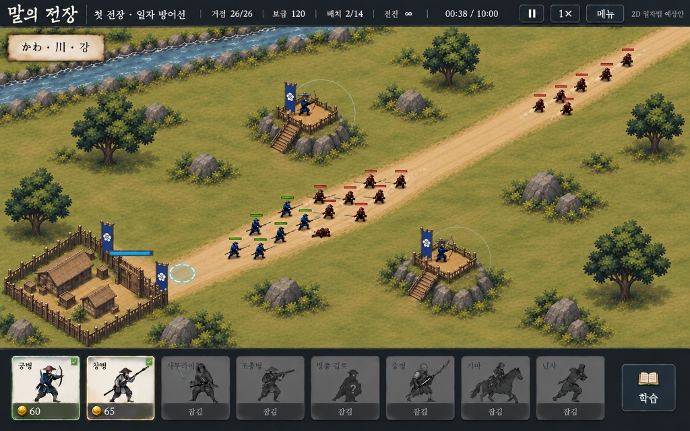

# 말의 전장

전국시대 전장에서 일본어를 배우는 Windows용 오프라인 전략·타워 디펜스 게임입니다. **고정된 쿼터뷰의 2D 배경과 병사 스프라이트** 위에서, 사격대에 배치한 궁병과 계속 모집·전진하는 창병 등이 실제로 교전합니다. 일본어 읽기와 뜻, 전장 문맥 과제와 전투 복귀가 게임 흐름에 포함됩니다.

**2026-10-27 소스 업데이트:** 개발 대상은 저장소 루트의 `project.godot` / `native/main.tscn`입니다. 등록된 실제 전장은 **Stage 01 마루네 요새와 Stage 02 오케하자마의 2개**입니다. 40단계 이야기 계획과 실제 제작된 전장 수는 구분합니다.

- 정해진 공격 사이클과 각 전장의 임무 조건으로 진행합니다. 이전의 10분·20분 시간제 설명은 현재 기준이 아닙니다.
- 기본 전투 속도는 기존 대비 1.25배를 표시상 **1×**로 사용하며, 선택 배속은 1× / 1.25× / 1.5×입니다.
- 전투 후 문제풀이와 오답 복습·진행 저장, 병종별 모집·스킬·동작, 대열·군집 교전 관련 수정이 포함됩니다.
- 최근 수정은 Stage 02의 첫 필수 병력 6명을 점유 지점에서 강제로 정지시키던 분기를 제거한 것입니다. 해당 병력도 일반 경로를 계속 따르도록 했습니다.
- 이번 업로드를 위해 게임을 실행하거나 검증을 새로 수행하지 않았습니다. 실제 보행·교전·밸런스·대량 병력 성능은 사용자 플레이 확인이 남아 있습니다. 과거 측정값을 최신 성능으로 취급하지 않습니다.

실행은 [Play.cmd](Play.cmd)를 사용합니다. 엔진은 자동 설치되지 않습니다. 저장 파일·로컬 프로필·캐시·실행 바이너리는 업로드 대상에서 제외합니다.

## 2026-10-12 개발·검증 기록

이하 내용은 당시 상태와 증거를 보존한 기록입니다. 조작법·임무·맵 수·성능을 포함해 최신 구현과 다른 부분이 있으며, 현재 상태는 위 업데이트와 실제 소스를 우선합니다.

## 실행과 첫 전투

1. 저장소 루트의 [Play.cmd](Play.cmd)를 실행합니다.
2. 시작 화면에서 **Enter**를 누르면 첫 전장의 넓은 출진 안내가 열립니다.
3. 일본어 지시문·후리가나·바로 아래 한국어 뜻과 조작 안내를 읽고 **확인 후 출진**을 누릅니다. 확인 전에는 전투 시간이 흐르지 않습니다.
4. 궁병 카드를 두 사격대로 끌어 배치하고, 창병을 모집해 길로 출진시킵니다. 비용과 생산 시간이 실제로 적용됩니다. 병사를 클릭하면 상태를 확인하고, **Space**로 일시정지하며 우측 책 버튼으로 학습 화면에 들어갑니다.

플레이어가 방어·난전·공성 중 하나를 고르는 모드 선택창은 없습니다. 해당 역사 이야기의 시나리오가 임무와 적 편성을 자동으로 지정합니다. 첫 임무는 **아군 철수 엄호**로 소개하지만, 현재 승패는 기존 시간제 생존/파상 규칙으로 판정합니다. 실제 아군의 탈출 인원·출구 도착 판정은 아직 없습니다.

실행기는 기존 `tools/godot/Godot_v4.7.2-stable_win64.exe`를 사용합니다. 엔진을 자동 설치하지 않으며, 다른 경로는 [tools/run.ps1](tools/run.ps1)의 `-GodotPath`로 지정할 수 있습니다. 편집기는 [Edit.cmd](Edit.cmd)로 엽니다. 아래 검증은 **Godot 4.7.2 Compatibility**에서 수행했습니다.

## 목표 이미지와 실제 게임 화면

### 현재 2D 화면의 목표

아래 이미지는 사용자가 제시한 최신 화면 기준입니다. 좌하단 요새, 우상단에서 이어지는 긴 길, 두 사격대, 좌상단 강과 숲의 구도·비율을 실제 게임과 비교합니다. 목표 이미지 자체를 실행 화면이나 구현 완료의 증거로 취급하지 않습니다.

### 실제 1440×900 전장

당시 캡처 파일은 현재 저장소에 포함되어 있지 않습니다.

### 실제 1280×800 전장

당시 캡처 파일은 현재 저장소에 포함되어 있지 않습니다.

### 출진 안내

당시 캡처 파일은 현재 저장소에 포함되어 있지 않습니다.

세 실제 화면 경로는 최종 검증 캡처의 문서용 위치입니다. 캡처를 위해 HUD·학습 문구를 숨기거나 불리한 영역을 잘라내지 않습니다. 실제 전장과 QA용 길·발 위치 오버레이는 구분합니다.

## 현재 2D 구현

| 항목 | 현재 상태 |
| --- | --- |
| 시점 | 각도가 고정된 쿼터뷰입니다. 자유 회전·사용자 확대·화면 이동을 전제로 하지 않습니다. 과거 3D 시험의 직교 폭 23.5·고도 44도 설정을 현재 2D 카메라 수치로 설명하지 않습니다. |
| 전장 | 1831×859의 그려진 배경에 요새·두 사격대·강·숲을 담았습니다. 배경에 병사나 HUD를 구워 넣지 않았으며 실제 병사와 전투 표시를 별도로 그립니다. 현재 첫 전장에서는 이전 3D 병사 월드·카메라·뷰포트를 초기화하지 않습니다. |
| 실제 좌표 | 그림의 입구·사격대·강과 연결되는 경로·배치·장애물 좌표를 사용합니다. 적은 맵 바깥의 `(1.07, -0.05)`에서 시작해 요새 앞 `(.255, .79)`로 걸어옵니다. 동일 적 ID가 화면 밖에서 가시 영역으로 들어오는 과정을 관측했습니다. |
| 병사 | 매끈한 비픽셀 그림체의 별도 병사 이미지를 실제 개체 위치에 표시합니다. 아군·적군의 색과 병종별 무기를 구분합니다. 화면의 병사가 전투 판정과 무관한 장식인 구조는 아닙니다. |
| 방향과 행동 | 궁병·창병의 **서로 다른 4개 대각선 방향 대기·공격 원화**를 별도 제작해 연결 중입니다. 타깃의 화면상 방향을 사용하고 공격 방출은 실제 전투 이벤트와 연결합니다. 전체 병종·방향·행동 애니메이션이 완성된 상태는 아닙니다. |
| 남은 동작 제약 | 기존 이동 원화는 주로 NE/SW 방향의 소수 프레임입니다. 다른 방향 이동과 다른 병종의 대기·공격·치료·사망 등은 제한되거나 대체 표시가 남아 있습니다. 이동 그림의 재사용이나 회전만으로 새 동작을 완성했다고 계산하지 않습니다. |
| 발과 접촉 | 프레임별 발 기준점을 실제 개체 좌표에 맞추고 부드러운 접촉 그림자를 그립니다. 그림자의 존재나 알파 영역의 아래끝만으로 발바닥 접촉을 합격 처리하지 않습니다. 긴 무기·옷자락·말굽과 실제 발을 구분한 전체 화면 확인이 필요합니다. |
| 글자와 카드 | 밝은 카드 바탕에 병사 썸네일을 표시합니다. 출진·학습 제목, 지시문·자막은 일본어/후리가나와 한국어 뜻을 같은 블록에 위아래로 배치합니다. 선택 병사 이름에도 같은 기준을 적용합니다. 시험에서 답을 드러내지 않도록 선택지 뜻을 숨기는 기존 규칙은 유지합니다. |

화면은 2D지만 **생산·이동·충돌·선택·공격·피해·학습은 실제 게임 상태**로 진행됩니다. 한 장의 정지 화면을 게임처럼 보여주는 방식이 아닙니다. 현재 그림체·병사 비율·방향별 실루엣과 전장 안에서의 가독성은 계속 검토할 항목입니다.

구현 근거: [전장 그림 렌더러](native/painted_battlefield.gd), [첫 전장 공간 연결](native/painted_stage.gd), [병사 렌더러](native/painted_actor_renderer.gd), [병사 자산 명세](assets/characters/painted-v1/manifest.json), [실제 UI와 시작 경로](native/main.gd), [일본어·한국어 조판](native/ruby_label.gd).

## 병력·교전·학습 규칙

- **정원:** 현재 병력 수와 생산 주문 수의 전역 상한은 없습니다. 과거 README의 배치형 정원 14·대기 주문 24 제한은 현행 규칙이 아닙니다. 비용·생산 시간·해금·유효 배치 공간·장애물·진지 조건은 계속 적용되며, 무제한 병력을 실제 성능 검증했다는 뜻은 아닙니다.
- **편성 성장:** 창병은 Lv.1/4/8에서 한 주문당 **1/3/5명**, 궁병은 Lv.1/5에서 **1/2명**입니다. 각 병사는 독립적으로 싸웁니다. 두 병종은 인원 증가가 주된 성장이고, 병사 한 명의 기본 공격력은 레벨당 2%, 체력은 1.5%씩 증가합니다. 진화로 개인 능력치를 크게 중첩 배증하지 않습니다.
- **소모·보충:** 창병 기본 주문은 25금·1.25초, 기본 체력 38·공격력 4.4·공격 간격 0.95초·기본 방어 0입니다. 궁병 주문은 60금·2.1초입니다. 수치가 최종 균형으로 확정된 것은 아닙니다. 계속 소모되는 전진 병력을 새 주문으로 보충하는 흐름을 구현합니다.
- **활성 병종 정의:** 궁병·창병·사무라이·조총병·승병·기마 무장·닌자가 있습니다. 해금 조건을 따르며 첫 전장 실기 검증은 유료 궁병·창병 중심입니다. **장도병은 비활성**이고 과거 데이터·관련 코드가 남아 있어도 현행 활성 병종으로 세지 않습니다.
- **대포조:** 별도 후방 지원 병종으로 계획에만 있습니다. **미구현**이며, 기존 **조총병은 유지**합니다. 조총병을 대포조로 바꾼 것도, 장도병 대신 대포조가 이미 등장하는 것도 아닙니다.
- **교전:** 주 전선의 적 흐름과 여러 사격 진지를 노리는 적 무리를 함께 다룹니다. 진지 근처에 투입한 전진 분대는 최초에 정해진 **지역 적 무리 전체**와 싸운 뒤 실제 경로로 돌아옵니다. 뒤늦게 오는 증원까지 계속 추적하는 명령으로 확대하지 않습니다.
- **적 편성과 진지:** 기본 보병 계열과 적 궁병·조총병·사무라이·기마 및 고정 사격 진지의 동작이 코드에 있습니다. 역사 시나리오별 적 구성·파상·단계 조건에 따라 사용됩니다. 현재 첫 전장의 적 프로필은 숲 접근이며 고정 적 사격 진지는 비활성입니다. 짧은 첫 전장 캡처로 후반 적과 모든 진지를 실제로 관측했다고 주장하지 않습니다.
- **학습:** 실제 출진 지시·일본어 단어와 읽기·한국어 뜻, 문장 빈칸과 전장 문맥 과제를 연결합니다. 책 버튼의 수동 학습과 전투 진행 중 자동 문맥 과제에서 실제 버튼으로 전투에 복귀합니다. 가시성과 첫 클릭 성공을 각각 검사합니다.

근거: [모집·전투 코드](native/game.gd), [이동·지역 교전](native/ground_combat.gd), [공통 성장 규칙](native/unit_growth.gd), [병종 데이터](native/units.json), [적 편성 프로필](native/enemy_mode_profiles.gd), [문맥 학습 화면](native/learning_field.gd).

## 40단계 이야기와 실제 콘텐츠의 경계

[시나리오 등록표](native/campaign_scenarios.json)에 **40개 이야기의 임무·적 편성·계획된 단계 전환**이 작성되어 있습니다. [연결 코드](native/campaign_scenarios.gd)가 현재 맵 ID에 해당하는 시나리오를 찾아 적용합니다. 플레이어가 같은 전장을 임의의 세 모드로 바꾸는 메뉴는 제거했습니다.

그러나 [맵 목록](native/maps.json)에 등록된 실제 전장은 Stage 01 하나입니다. 40개 맵을 새로 제작하거나 플레이 가능하게 해금한 상태가 아닙니다. 철수·호송·진격·추격 차단·포위·연락/인계의 **실제 도착·탈출·점령·인계 성공/실패 판정과 단계 전환은 아직 구현되지 않았습니다.** 현재 시간제 생존/기존 파상 승패를 그 임무 판정으로 부르지 않습니다.

첫 이야기의 철수 엄호 문구 역시 서사와 제작 의도를 전달합니다. 역사적 전투 결과와 가상 부대의 게임 임무 성공은 구분합니다. 등록표의 병력 편성·공격 간격·향후 대포조 배치는 게임 설계이며 당시 실제 전술의 검증 자료가 아닙니다. [40단계 원래 계획](CAMPAIGN_STORY_MODE_PLAN_2026-10-08.md)과 [역사·전장 제작 근거](BATTLEFIELD_HISTORY_WEATHER_PLAN.md)는 이 경계 안에서 참고합니다.

## 길·발 위치와 실제 입력 검증

[길 정렬 조사](tests/profiles/painted-game-01/road-alignment.json)는 깨끗한 배경 이미지의 흙길 색 영역을 실제 경로 및 관측된 적 좌표와 비교했습니다. 관측된 이동 중 적의 발 기준점 **185/185개가 길 영역 안**에 있었습니다. 그림의 길 중앙은 조금 휘고 게임 경로는 직선이므로, 중간 굽이의 중앙선 차이는 1440 전장 기준 최대 **약 16.3px** 남습니다. 이는 길 경계의 색 분류와 발 기준점 검사이며, 모든 프레임의 실제 발바닥 픽셀이 땅에 붙는다는 증명은 아닙니다.

2026-10-12의 [실행 기록 run-1791773099](tests/profiles/painted-game-01/run-1791773099/report.json)에서는 다음 실제 경로를 확인했습니다.

- Home Enter → 출진 안내 → 첫 확인 클릭 → 전투.
- 두 사격대의 유료 궁병 배치와 창병 모집, 자연 생산 완료.
- 실제 병사 클릭·선택 상태·체력 표시, 자연 공격과 적 체력 감소.
- 같은 적 ID의 화면 밖 생성과 화면 안 접근.
- 첫 클릭 일시정지/재개, 수동 학습 복귀 1회, 자동 문맥 학습 복귀 1회.
- 1440×900·1280×800 전체 캡처 보존.

이 실행은 **전체 통과가 아닙니다.** 책 버튼 내부의 한 지점으로 대각선 이동한 직후 한 프레임의 호버가 두 해상도에서 `null`이었습니다. 중앙의 실제 책 클릭과 학습 복귀는 통과했습니다. 최신 [통합 QA](tests/qa_painted_game.gd)는 입력을 한 번만 보내고 즉시·다음 두 프레임의 호버와 실제 포인터 위치를 기록합니다. 첫 실패를 지우거나 두 번째 클릭으로 우회하지 않습니다. 일본어/한국어 줄 위치·팝업 스크롤·선택 이름의 잘림 검사도 추가했으며, 새 실행 결과와 과거 증거는 별도로 보존합니다.

QA는 작업 폴더 안의 격리 사용자 프로필과 새 시험 저장을 사용했습니다. 실제 플레이 저장을 변경하지 않았습니다. 관련 없는 과거 전체 검사나 40맵 전제의 콘텐츠 검사를 통과한 것으로 합산하지 않습니다.

## 자연 전투 성능 기록

아래는 최신 동작 통합 전의 **2026-10-12 11:44:59 KST, run-1791773099** 기록입니다. Godot 4.7.2 Compatibility / Intel Iris Xe / 1440×900, VSync 켜짐, 엔진 FPS 제한 0에서 측정했습니다. 캡처·창 크기 변경·선택 입력·일시정지·학습 구간은 제외했습니다.

| 항목 | 관측값 |
| --- | ---: |
| 유효 자연 전투 시간 | 12.015초 |
| 유효 프레임 수 | 714 |
| 프레임 p50 / p95 | 16.708 / 18.330ms |
| 50ms 초과 프레임 | 1회 |
| 아군 수 / 적 수 | 3 / 2–8 |
| draw calls p50 / p95 | 243 / 268 |
| 루트 뷰포트 GPU p50 / p95 | 1.382 / 1.466ms |

GPU 값은 지원되는 루트 뷰포트의 비동기 API 결과입니다. CPU 프레임과 같은 순간의 측정이나 전체 시스템 GPU 비용으로 확대하지 않습니다. 이 짧은 구간으로 **전체 게임 60FPS나 많은 병력의 성능을 보장하지 않습니다.** 이전 3D 시험과 병사 수·화면·측정 조건이 달라 개선율을 계산하지 않습니다. 새 방향별 동작과 UI 변경 이후의 성능은 최종 실행 기록으로 다시 구분해야 합니다.

## 남은 문제

- 궁병·창병의 새 방향별 대기·공격이 실제 타깃 방향·발사 시점과 맞는지, 같은 원화를 돌리거나 재사용한 것처럼 보이지 않는지 전장 크기에서 확인해야 합니다. 다른 병종의 행동과 전체 방향 이동은 아직 부족합니다.
- 발 기준점·그림자 설정과 실제 보이는 발 접촉을 구분해야 합니다. 배경 길 중간의 약 16px 중앙선 차이와 사격대 위 병사의 접촉도 그대로 검토 대상입니다.
- 밝은 카드와 작은 자막을 적용했지만, 최신 번역 묶음·좁은 해상도의 팝업·선택 라벨·호버 결과는 마지막 통합 실행에서 확인해야 합니다.
- 40개 이야기 등록을 실제 맵·임무 판정·캠페인 완성으로 연결하는 작업은 남아 있습니다. 대포조도 미구현입니다.
- 목표 이미지와 똑같은 화면, 모든 병종 애니메이션 완성, 장시간·대규모 전투 성능을 확보했다고 보고하지 않습니다.

## 이전 3D 기록과 보존 범위

이전 Blender/3D 회차는 비교 자료로 보관합니다: [당시 실제 화면](docs/map-remaster-reference/11-stage01-actual-blender-pilot-1440x900.png), [제작 보고](tools/art-authoring-pilot/work/20261010T050221Z-581667a1/HQ_BLENDER_REPORT.txt), [QA 감사](tools/art-authoring-pilot/work/20261010T050221Z-581667a1/QA_BLENDER_FINAL_AUDIT.json), [Blender 원본](tools/art-authoring-pilot/work/20261010T050221Z-581667a1/assets/correction/authored_assets.blend), [GLB](tools/art-authoring-pilot/work/20261010T050221Z-581667a1/assets/correction/stage01_assets.glb), [색 처리 진단](tools/art-authoring-pilot/work/20261010T050221Z-581667a1/FUN_MATERIAL_DIAGNOSIS.json). 당시 수관·재질·바닥 그림자 절충과 직교 카메라 수치는 과거 시험의 상태이며 현재 2D 전장의 설정으로 재사용하지 않습니다.

`tests/profiles/r8-lag-01/candidate`와 과거 격리 시험본, 바탕화면 R8은 이번 루트 2D 작업으로 교체하지 않았습니다. README 갱신이나 소스 수정만으로 설치본 배포가 완료되지 않습니다. 개인 저장·캐시·별도 생성 런타임은 공개 자료와 분리합니다. [과거 밸런스 보고](GAME_BALANCE_REVIEW.md)의 옛 정원·병종·40맵 설명보다 현재 루트 소스를 우선합니다.

`src/`, `index.html`, `server.mjs`는 과거 웹 프로토타입입니다. 음악·음성·폰트·모델·텍스처의 출처와 이용 조건은 해당 자산의 라이선스·출처 자료를 따릅니다.
